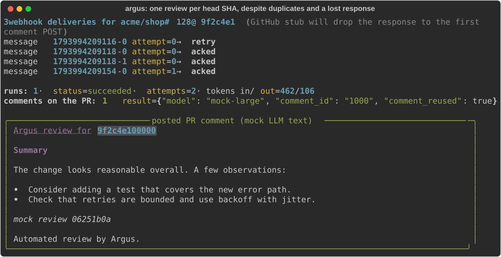
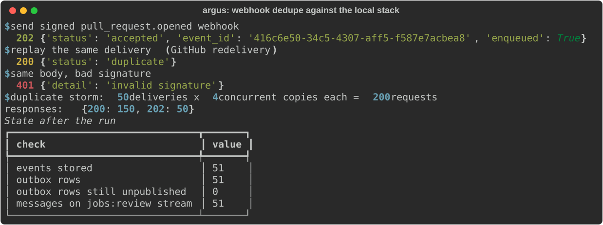
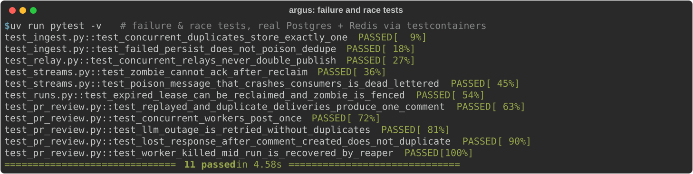
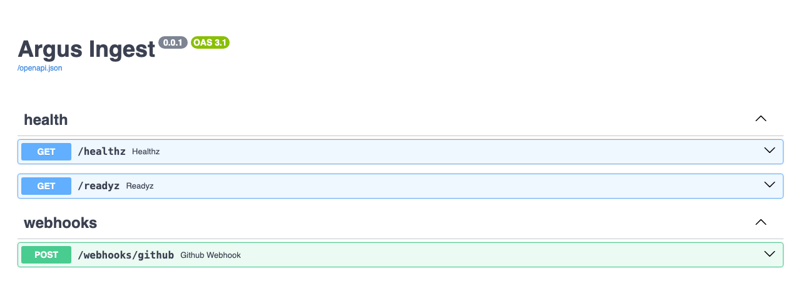
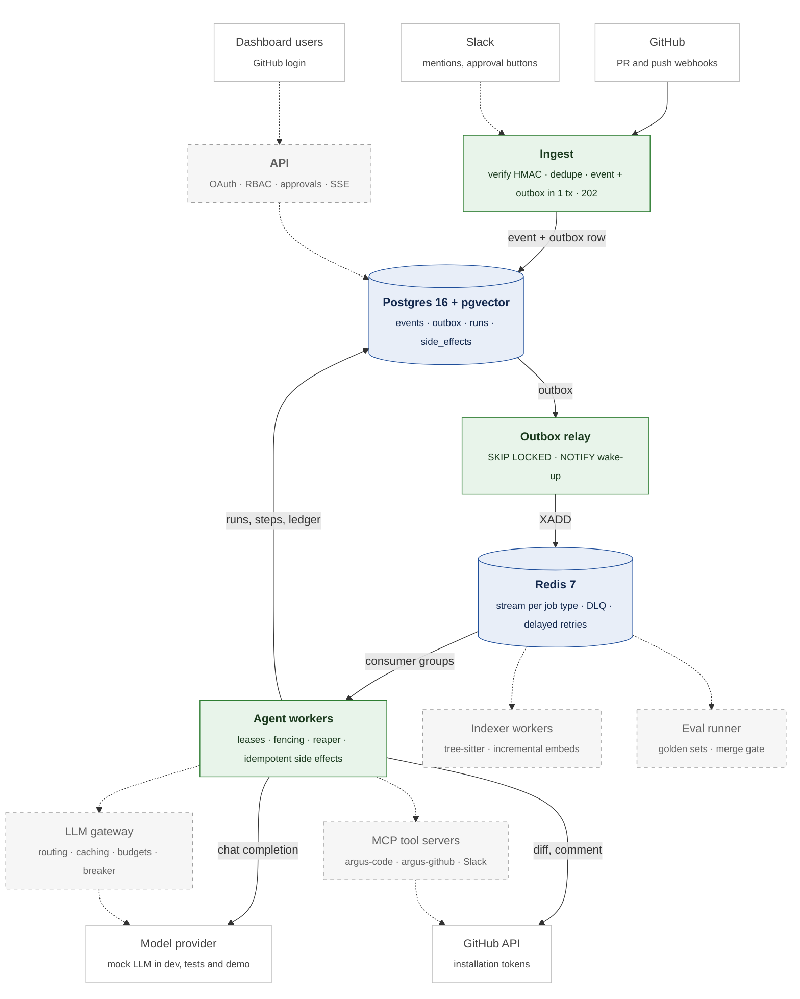
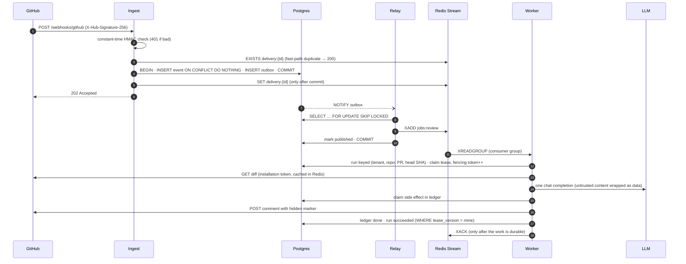

<div align="center">

# Argus

**A multi-tenant AI agent platform for engineering teams.**
Install a GitHub App and every pull request becomes a durable, crash-safe agent job that reviews the change against your codebase and posts the result back. It runs effectively once, no matter how many times GitHub redelivers.

[](https://github.com/PRAJINRAJ-RANAWAT/Argus-Multi-Tenant-AI-Agent-Platform/actions/workflows/ci.yml)
[](https://github.com/PRAJINRAJ-RANAWAT/Argus-Multi-Tenant-AI-Agent-Platform/actions/workflows/deploy.yml)
[](https://github.com/PRAJINRAJ-RANAWAT/Argus-Multi-Tenant-AI-Agent-Platform/tags)


[Why](#why-argus) · [See it work](#see-it-work) · [Architecture](#architecture) · [Guarantees](#guarantees-and-how-they-are-proven) · [Quick start](#quick-start) · [Roadmap](#roadmap) · [Docs](#documentation)

</div>

---

## Why Argus

The LLM call is the easy part. The hard part is everything around it:

| Problem | What actually happens | What Argus does |
|---|---|---|
| **Bursty, duplicated events** | GitHub redelivers webhooks; a force-push fires 5 events in a second | Signature check → dedupe → event + outbox in one transaction → 202 in milliseconds |
| **Long, failure-prone work** | A review takes minutes and dozens of calls; workers crash; providers go down | Runs are persisted state machines with leases, fencing tokens and a reaper |
| **Side effects under retries** | At-least-once delivery means "post the comment" can run twice | A side-effect ledger plus a hidden marker in the GitHub comment: one comment per head SHA |
| **Shared, expensive resources** | One noisy tenant can starve the rest or blow the budget | Per-tenant queues, token buckets and budgets *(M5, M9)* |
| **Untrusted input everywhere** | PR descriptions and code comments can carry prompt injections | Untrusted content is wrapped and labelled as data, with capability limits *(hardened in M6)* |

## See it work

### One review per head commit, despite duplicates and a lost response

Three webhook deliveries arrive for the same PR head. The stub GitHub API **creates the comment but drops the response** to the first POST, so the worker cannot know whether its comment was posted. The retry takes a newer lease, finds the hidden marker on the PR, and records it instead of posting again.

<p align="center"></p>

<sub>Real run of the review worker against the local stack's Postgres and Redis. The GitHub API is the stub from the test suite and the review text comes from the bundled mock LLM, so it's canned. A screenshot from a live install goes here once the GitHub App is deployed.</sub>

### Webhook dedupe under a duplicate storm

Against the Docker Compose stack: a signed delivery, a redelivery, a forged signature, then 200 concurrent requests (50 deliveries × 4 copies).

<p align="center"></p>

### Failure and race tests

These tests run on every pull request against real Postgres and Redis (testcontainers) and simulate the failures, not just the happy path:

<p align="center"></p>

### Ingest service API

<p align="center"></p>

## Architecture



<sub>Green = built and tested · blue = data stores · dashed = planned milestone. Full design: [docs/SPEC.md](docs/SPEC.md).</sub>

### The path of one pull request



## Guarantees and how they are proven

| Guarantee | Mechanism | Proven by |
|---|---|---|
| A redelivered webhook is stored once | `UNIQUE (source, delivery_id)` is the truth; Redis is a post-commit cache ([ADR 0003](docs/adr/0003-webhook-dedupe-and-outbox.md)) | 20 concurrent identical deliveries → 1 event; Redis flushed or down → still deduped |
| A crash mid-request never loses an event | Redis key set only after `COMMIT`, so a failed persist leaves the delivery retryable | `test_failed_persist_does_not_poison_dedupe` |
| DB write and queue publish never diverge | Transactional outbox + relay; at-least-once with idempotent consumers | 6 relays × 500 rows → each published once; crash between `XADD` and `COMMIT` → republished, still 1 comment |
| A dead worker's job is picked up | Consumer-group pending list + `XAUTOCLAIM`; poison messages bounded and dead-lettered | `test_poison_message_that_crashes_consumers_is_dead_lettered` |
| A zombie worker cannot corrupt state | Ownership-checked `XACK` (Lua) and a `lease_version` fencing token on every run write | `test_zombie_cannot_ack_after_reclaim`, `test_expired_lease_can_be_reclaimed_and_zombie_is_fenced` |
| A run is never stuck | Runs, not messages, are durable; a reaper requeues expired leases through the outbox ([ADR 0005](docs/adr/0005-runs-are-the-unit-of-durability.md)) | `kill -9` emulation mid-run → recovered, 1 comment |
| Zero duplicate reviews per (repo, PR, head SHA) | Idempotent run key + side-effect ledger + hidden marker reconciliation | duplicate storm, 3 concurrent workers, lost GitHub response → always exactly 1 comment |
| Retries don't stampede | Exponential backoff with full jitter via a delayed ZSET; failure transitions are atomic Lua scripts ([ADR 0004](docs/adr/0004-queue-redis-streams.md)) | LLM outage → retried, `attempts = 2`, 1 comment |

### Design targets

Designed for **500 tenants and 100,000 events/day** (300/s replay bursts, ~450 concurrent runs at peak), proven with load tests against the mock LLM in M9.

| SLO | Target |
|---|---|
| Webhook acknowledged | p99 < 300 ms |
| PR opened → first review comment | p95 < 2 min |
| Codebase Q&A time to first token | p95 < 3 s |
| Duplicate reviews per (repo, PR, head SHA) | 0 |
| Lost events | 0 (every accepted event ends completed, failed with a reason, or in the DLQ) |
| Cross-tenant data access | 0, covered by automated tests |

## Quick start

Requirements: Docker, [uv](https://docs.astral.sh/uv/), Python 3.12.

```bash
git clone https://github.com/PRAJINRAJ-RANAWAT/Argus-Multi-Tenant-AI-Agent-Platform.git argus
cd argus
make install   # uv sync + git hooks
make up        # Postgres, Redis, migrations, ingest, api, relay, worker, mock LLM
make check     # ruff, mypy --strict, pytest (real Postgres + Redis via testcontainers)
```

| Service | URL |
|---|---|
| Ingest (webhooks) | http://localhost:8001 · [docs](http://localhost:8001/docs) |
| API | http://localhost:8000 · `/healthz`, `/readyz` |
| Mock LLM | http://localhost:8090 · `POST /_admin/faults` to inject latency, 429s, 500s, outages |

Send a signed webhook to the local stack (the dev secret is `dev-webhook-secret`):

```bash
uv run python - <<'EOF'
import httpx
from tests.factories import pr_payload, signed_request
body, headers = signed_request(pr_payload(), "dev-webhook-secret")
for _ in range(2):
    r = httpx.post("http://localhost:8001/webhooks/github", content=body, headers=headers)
    print(r.status_code, r.json())   # 202 accepted, then 200 duplicate
EOF
```

Break the model provider on purpose:

```bash
curl -X POST localhost:8090/_admin/faults -H 'content-type: application/json' \
     -d '{"outage": true}'          # every completion now returns 500
curl -X POST localhost:8090/_admin/faults -H 'content-type: application/json' -d '{}'   # recover
```

## Project layout

```
src/argus/
  ingest/      webhook endpoint: verify → dedupe → event + outbox
  queue/       Redis Streams queue, consumer loop, outbox relay
  agents/      PR review agent
  runs.py      runs: idempotent create, lease claim, fencing, reaper
  tools/       side-effect ledger (exactly-once external calls)
  github/      webhook signatures, App JWT, installation tokens, REST client
  llm/         OpenAI-compatible client (gateway arrives in M5)
  mock_llm/    fault-injecting mock provider for tests, load tests and demos
  api/ worker/ db/   API service, worker process, pool + migration runner
migrations/    forward-only SQL, advisory-locked, checksummed
deploy/        production compose, Caddy (auto TLS), deploy script
docs/          spec, ADRs, progress, deploy and GitHub App guides
```

## Tech stack

| Layer | Choice |
|---|---|
| Services | Python 3.12, FastAPI, asyncio, asyncpg (raw SQL), redis-py |
| Data | Postgres 16 + pgvector (source of truth, outbox, RLS, vectors) |
| Queue, locks, limits | Redis 7: Streams, Lua scripts, sorted sets |
| Quality | ruff, mypy `--strict`, pytest + testcontainers, gitleaks |
| Delivery | GitHub Actions → GHCR image per commit → SSH deploy to a VPS behind Caddy + Cloudflare, smoke-tested on the deployed `git_sha` |
| Planned | tree-sitter, MCP official SDK, OpenTelemetry, Prometheus, Grafana, Langfuse, k6 |

## Roadmap

| Milestone | Scope | Status |
|---|---|---|
| **M0** · Skeleton | Monorepo, Compose, CI, deploy pipeline | ✅ `v0.0.0` (live deploy pending VPS) |
| **M1** · Webhook → review comment | GitHub App, signature check, dedupe, outbox, Streams, worker, idempotent comment | ✅ `v0.1.0`, `v0.1.1` (live install pending App) |
| **M2** · Durable agent runtime | Step checkpointing, heartbeats, MCP tool loop, supersede on new commit, DLQ replay | ⏳ next |
| **M3** · Code RAG | tree-sitter chunking, incremental indexing, hybrid search, cited Q&A in Slack | |
| **M4** · Tenancy and auth | GitHub OAuth, roles, row-level security, audit log, live dashboard over SSE | |
| **M5** · LLM gateway | Provider adapters, routing, prompt and semantic caching, token buckets, budgets, circuit breaker | |
| **M6** · Guardrails | Injection classifier, secret/PII scanning, Slack approval flow, measured attack success rate | |
| **M7** · Observability | One OpenTelemetry trace from webhook to comment, Grafana, SLO burn-rate alerts | |
| **M8** · Evals in CI | Golden PR, Q&A and safety sets, LLM judge, merge gate | |
| **M9** · Scale and chaos | Fair scheduling, autoscaling on lag, published load and chaos report | |

Live status: [docs/PROGRESS.md](docs/PROGRESS.md).

## Documentation

- [Specification](docs/SPEC.md): problem statement, SLOs, capacity estimates, deep dives
- Architecture decisions:
  [0001 monorepo and tooling](docs/adr/0001-monorepo-and-python-tooling.md) ·
  [0002 single-VPS deploy](docs/adr/0002-single-vps-compose-deploy.md) ·
  [0003 webhook dedupe and outbox](docs/adr/0003-webhook-dedupe-and-outbox.md) ·
  [0004 Redis Streams vs Kafka vs NATS](docs/adr/0004-queue-redis-streams.md) ·
  [0005 runs are the unit of durability](docs/adr/0005-runs-are-the-unit-of-durability.md)
- [Deploying to a VPS](docs/deploy.md) · [Registering the GitHub App](docs/github-app.md)

## Contributing

Work happens on `dev`; `main` is production and only receives merge commits from reviewed, green PRs, each tagged `v0.<milestone>.<n>`. Commits follow [Conventional Commits](https://www.conventionalcommits.org/). Run `make check` before pushing.
